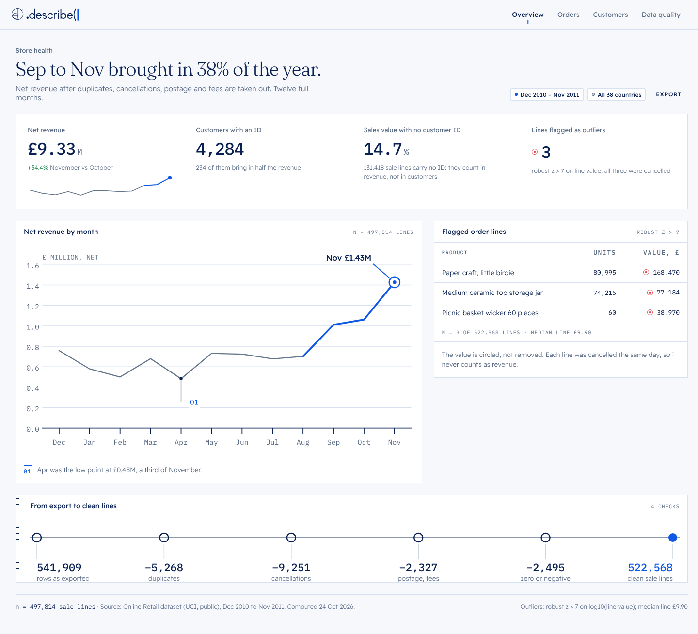
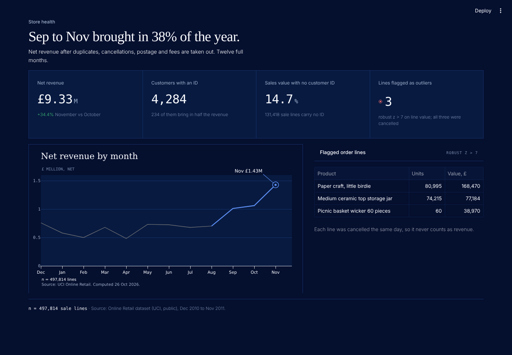

# Data apps

How a .describe( dashboard is put together: the page, its parts, and the rules
that keep it reading as one instrument. One reference page, built two ways.

```
python3 apps/build.py --render          apps/out/dashboard.html, dashboard-dark.html, png/
                                        and apps/.streamlit/config.toml (from the tokens)
cd apps && streamlit run streamlit_app.py
python3 templates/check.py              the rules below, checked (CI: templates.yml)
```

| Static (light) | Streamlit (dark) |
|---|---|
|  |  |

The static page reads `tokens/dist/tokens.css`, `ui/ui.css` (the components in
`ui/UI.md`) and `apps/app.css` (the shell). Streamlit reads the same three files
through `describe_streamlit.use()`.

---

## The page, top to bottom

| # | Part | Static | Streamlit | Rule |
|---|---|---|---|---|
| 1 | **Nav** | `d-nav` with the compact lockup | Streamlit's own chrome | Four sections at most. The current one is marked, not coloured |
| 2 | **Header** | `.app__head`: eyebrow, title, dek, filters | `S.header(label, title, dek)` | The title is the finding, in a sentence ("Sep to Nov brought in 38% of the year"), never the dataset's name. The eyebrow is sans: mono never sits above a heading |
| 3 | **KPI tiles** | `.kpis` / `.kpi` | `S.kpis([S.kpi(...)])` | Four tiles. Value in mono, unit small beside it, one line of meaning under it. Deltas take `--pos` / `--neg` by meaning, not by sign |
| 4 | **Sparkline** | `sparkline(values, story_from)` | none | The tile's own series. Context grey, the story stretch blue, a dot on the latest value; no axes |
| 5 | **Chart panel** | `d-panel` with the chart kit SVG | `st.plotly_chart(fig, theme=None)` | One index mark (`D.index_mark` / `P.index_mark`), callouts by number with the sentence under the chart |
| 6 | **Table panel** | `d-table` in `.grid2` | `st.dataframe` | Numbers right-aligned in mono. An outlier carries the coral marker on its value and the panel names the rule |
| 7 | **Method strip** | `d-panel--edge` + `K.process(...)` | optional | From the raw export to what the page counts, every step with its count |
| 8 | **Provenance** | `.provenance` | `S.source(n, source)` | n, source, computed date. Every page ends on it; `S.source()` refuses an empty n or source |

## Colour

- **Blue** (`--active`) is the one story: the story series, the index mark, the
  current nav item, the primary action.
- **Coral** (`--mark`) is only for outliers under a named test: the
  `d-outlier` marker on the flagged values and on the tile that counts them.
  `S.kpi(..., rule=...)` is the only way to put it on a tile, and it writes the
  rule into the tile.
- **Green and red** are for deltas by meaning: revenue up is `--pos`, returns
  up is `--neg`.
- Light or dark follows the viewer. The static page takes `data-theme`;
  Streamlit takes its own setting (Settings → Theme, or the system), and
  `use()` pins the tokens to that mode so the page and Streamlit's chrome never
  disagree.

## Streamlit

`apps/.streamlit/config.toml` is generated from the tokens by `apps/build.py`
(one section per mode: primary, ground, panel, ink, rule; Readex Pro, Fraunces
and IBM Plex Mono; a 2px radius). Don't edit it by hand; `templates/check.py`
fails if it drifts. Streamlit reads it from the folder you run in, so run from
`apps/`, or copy the folder next to your own app.

To start a new app, copy `streamlit_app.py`, keep `S.use()` first and
`S.source()` last, and replace the figures with your own (computed, never
typed). Pass `theme=None` to `st.plotly_chart` or Streamlit will repaint the
chart with its own palette.

## Rules that are code

`templates/check.py` builds the static dashboard and fails if:

1. `apps/` types a colour instead of reading a token;
2. coral appears anywhere but the flagged values and the tile that counts them,
   or appears in the chart;
3. a page has no source line;
4. a mono label sits above the title;
5. `.streamlit/config.toml` no longer matches the tokens;
6. `S.kpi()` stops writing an outlier tile's rule into the tile.
