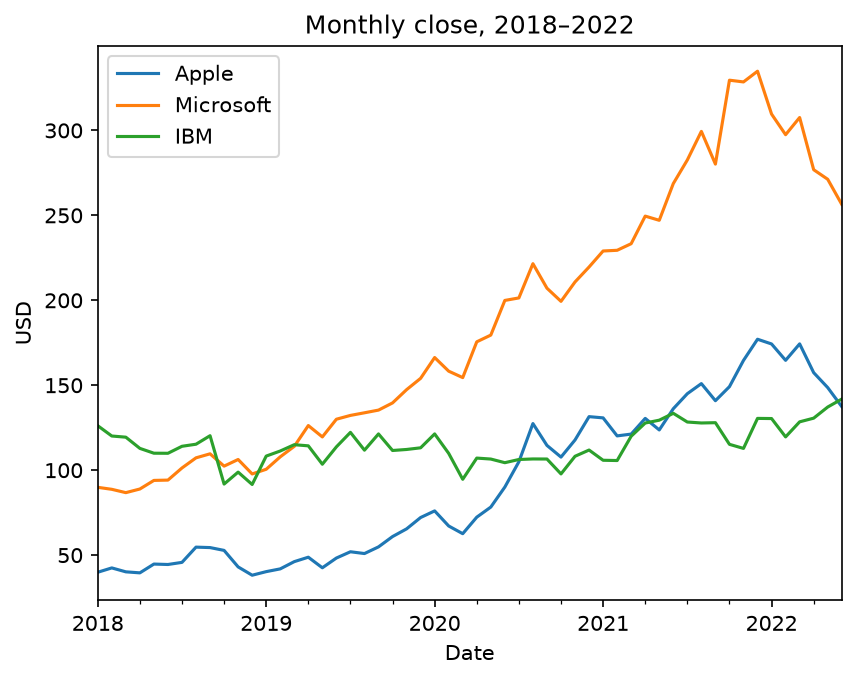
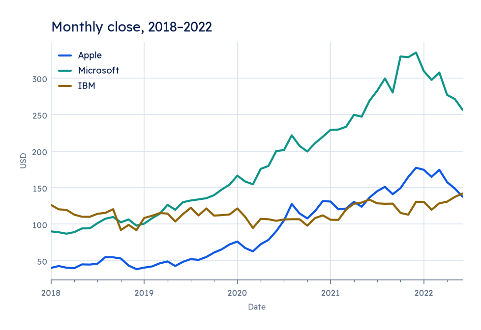
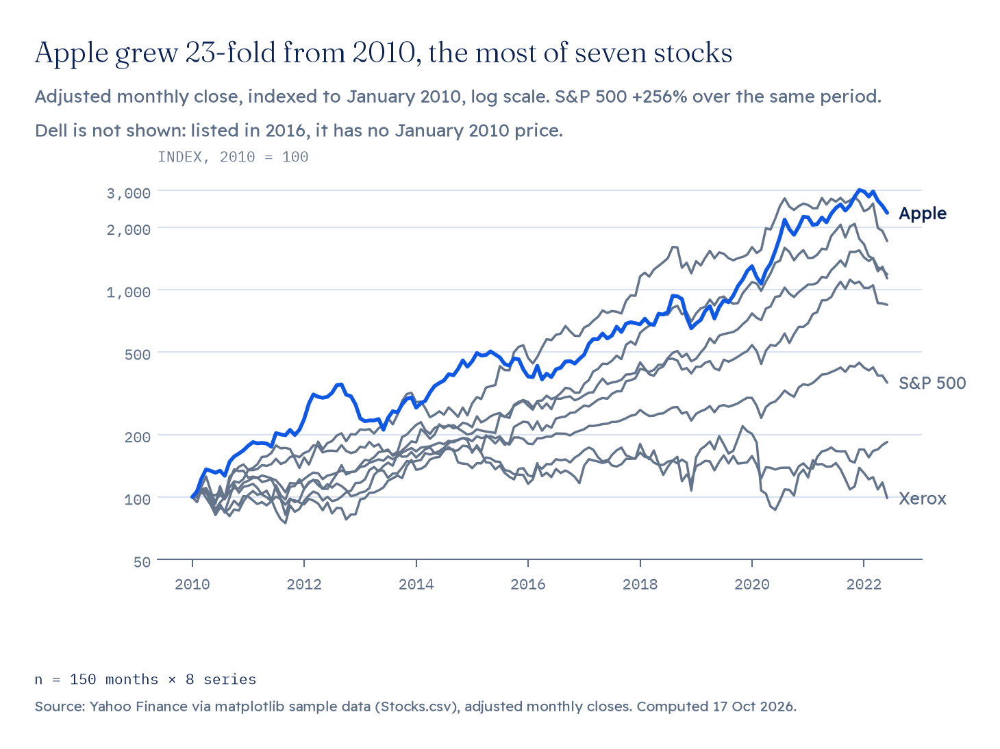
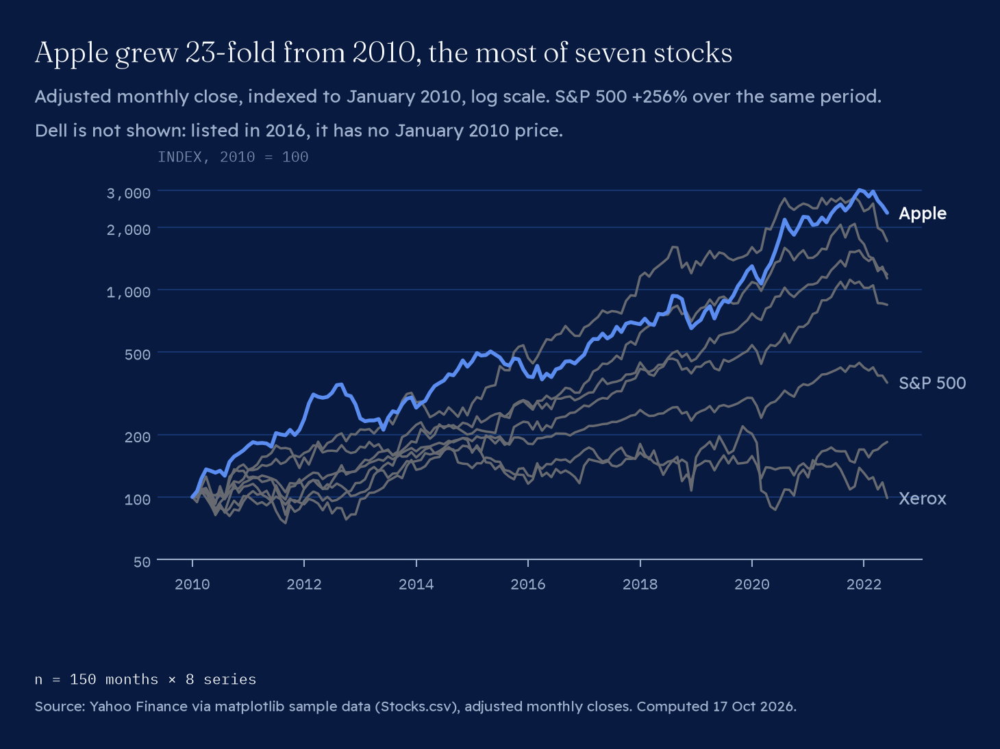
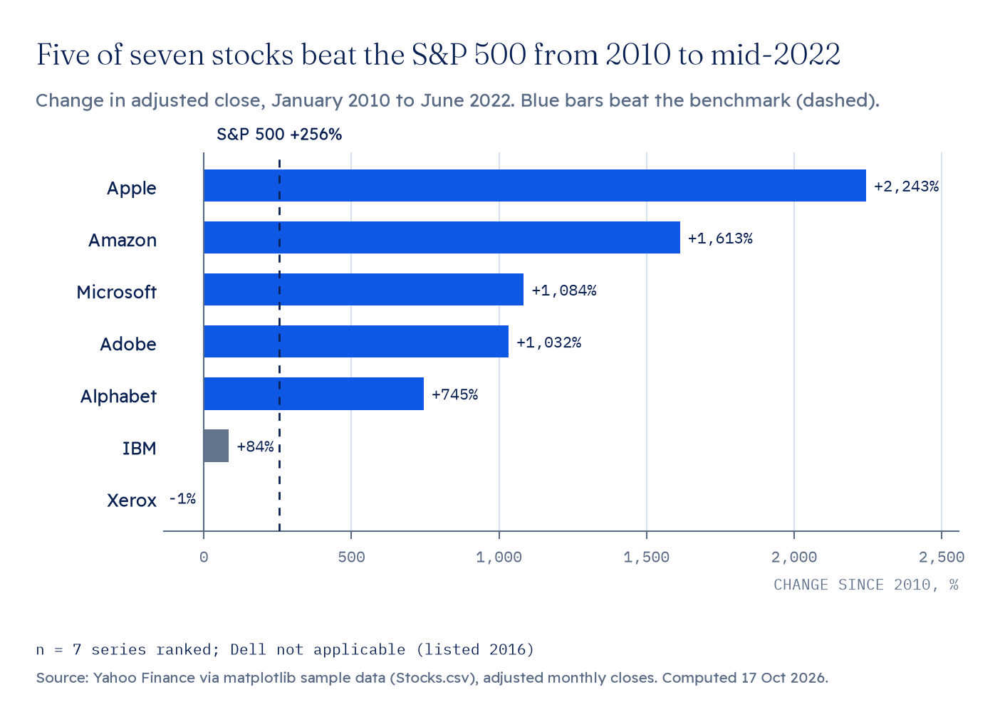
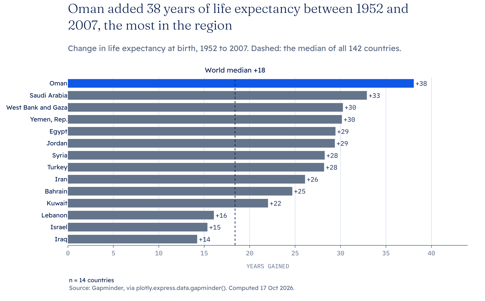
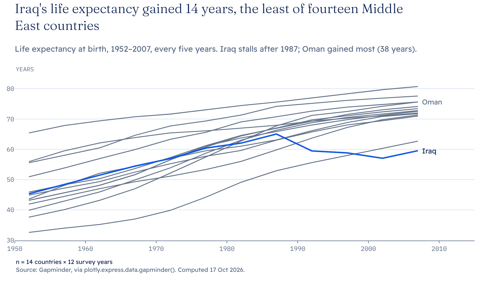
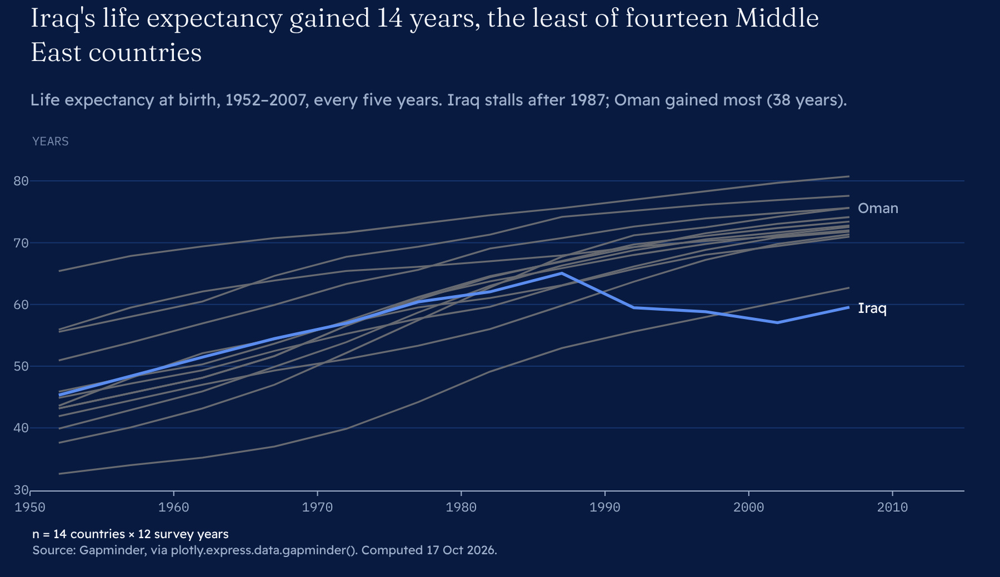

# describe_charts — the data-viz kit

Brand palette and type for **matplotlib, pandas, seaborn and Plotly**, the
chart rules from [`../CHARTS.md`](../CHARTS.md) as helpers that refuse to
break them, and a short branded **HTML / PDF report** template.




*The same untouched analysis code, before and after `describe_charts.use()`.*

---

## Adopt it in an analysis repo (DataAnalytics_Automation, notebooks)

**1. Install** (once per environment; add the line to `requirements.txt`):

```
describe-charts[all] @ git+https://github.com/describedatateam/describe-brand-system#subdirectory=charts/kit
```

**2. The one-line change.** At the top of the script or the first notebook cell,
after the imports:

```python
import describe_charts; describe_charts.use()          # or use("dark")
```

Every chart drawn after it — `plt.plot`, `df.plot()`, seaborn, `plotly.express`
— takes the brand look. Nothing else in the code has to change.

**3. Fonts** (once per machine): `python -m describe_charts fonts --install`
downloads Fraunces, Readex Pro, IBM Plex Mono and Vazirmatn (SIL OFL) from
Google Fonts and cuts the static weights the type system specifies. Without
it, charts fall back to DejaVu quietly. The repo does not ship the faces
(see `NOTICE.md`).

Two notes for existing code:

- **seaborn**: `sns.set_theme()` resets matplotlib's style. Call
  `describe_charts.use()` *after* it, or drop the `set_theme` call.
- **Several series in one chart** get the categorical palette from the design
  tokens, in its fixed order: blue, verdigris, brass, plum, moss, sky. Scatter
  plots and maps should use only the first three; a seventh series folds into
  Other or facets (`tokens/TOKENS.md`). When the chart has a finding, make it
  a story chart instead: `emphasise()` / `story()` turns one series blue and
  the rest context grey.
- Colormaps: `describe_seq_light` / `_dark` (the blue scale, the default
  `image.cmap`) and `describe_div_light` / `_dark` (brass below zero, blue above).
  Plotly gets the same as its `sequential` and `diverging` scales.

---

## Make a chart properly

The theme gets the look. The helpers get the rules: title is the finding,
one story series, every chart states n and source, coral only for an outlier
with its test, dashed only for a benchmark.

### matplotlib

```python
from describe_charts import mpl as D
D.apply()                                          # already done by use()
fig, ax = plt.subplots()
for name in others: D.context(ax, x, df[name])
D.story(ax, x, df["Apple"])                         # once per axes, raises on a second
D.label_end(ax, x[-1], df["Apple"].iloc[-1], "Apple", story=True)
D.benchmark(ax, 100, "Base")                        # the only dashed line
D.outlier(ax, x0, y0, rule="|z| > 3", label="Mar 2020")   # raises without the rule
D.units(ax, y="Index, 2010 = 100")                  # mono, uppercase, ≤ 4 words
D.finish(fig, ax, "Apple grew 23-fold from 2010", n="n = 150 months",
         source="Yahoo Finance", dek="Adjusted monthly close.", path="chart.png")
```

`D.ranked_bars(ax, labels, values, highlight=[...])` draws the ranked bar
form; `meaning=True` colours by good/bad instead (never both, rule 10).

### Plotly

```python
from describe_charts import plotly_theme as P
fig = px.line(df, x="year", y="lifeExp", color="country")   # template already applied
P.emphasise(fig, "Iraq")                    # story blue; every other trace context grey
P.benchmark(fig, 70, "Target 70")
P.finish(fig, "Iraq gained the least", n="n = 14 countries",
         source="Gapminder", dek="1952–2007.", units=("", "Years"))
```

Templates are registered as `"describe"` and `"describe_dark"`
(`fig.update_layout(template="describe_dark")`). PNG/SVG export goes through
kaleido, which needs Chrome; set `BROWSER_PATH` if it can't find one.

### Report

```python
from describe_charts.report import Report
r = Report("Q3 sales review", dek="What moved, and what didn't.", client="Acme")
r.section("Summary").text("Revenue rose in **eight of ten** regions.")
r.stats([("+12%", "Revenue vs Q2", "n = 10 regions")])
r.figure(fig)                                   # matplotlib or Plotly
r.table(df, n="n = 10 regions", source="Acme ERP")   # NaN prints as an em dash, never 0
r.save_html("report.html")                      # Plotly stays interactive
r.save_pdf("report.pdf")                        # A4, cover, running footer, page numbers
```

Worked example: [`examples/out/report.pdf`](examples/out/report.pdf) /
[`report.html`](examples/out/report.html).

---

## Examples

`python3 charts/kit/examples/build.py` renders everything in `examples/out/`
from public sample data (Stocks.csv via matplotlib, audited by
`charts/examples.py`; Gapminder via plotly.express). Nothing is invented.

| | |
|---|---|
|  |  |
|  |  |
|  |  |

---

## Files

| Path | What it is |
|---|---|
| `describe_charts/tokens.py` | Reads colour from the brand's design tokens (`tokens/dist/tokens.json`) when run from this repo. |
| `describe_charts/tokens.json` | A snapshot of those values for pip installs, plus the kit's own fonts, sizes and strokes. Never hand-edited: after a token change run `python3 charts/kit/check.py --write`. |
| `describe_charts/mpl.py` | matplotlib rcParams + helpers |
| `describe_charts/styles/*.mplstyle` | Generated from tokens, for `plt.style.use(path)` without importing the kit. `python -m describe_charts styles` |
| `describe_charts/plotly_theme.py` | Plotly templates + helpers |
| `describe_charts/report.py`, `templates/report.html` | The report |
| `describe_charts/fonts.py` | Finds, downloads and instances the brand faces |
| `check.py` | Snapshot and styles in sync with the design tokens, lockup unchanged, rule guards still raise. Runs in CI (`.github/workflows/charts-kit.yml`). |

## Open

- `charts/mpl/mpl_describe.py` predates this kit. It can become a thin shim
  over `describe_charts.mpl` once this is merged.
