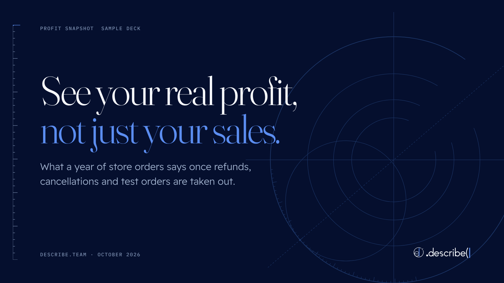
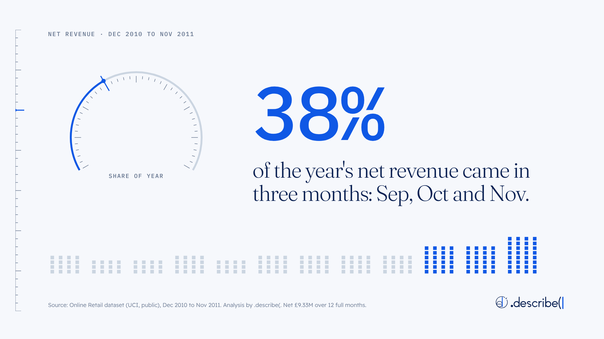

# The enrichment layer

What makes a .describe( page richer than type on a ground, without adding a new
style. Every element below comes from a library that already exists
(`geometry/`, `illustrations/`, the tokens), has one job, and is built into the
slide and social templates. `templates/kit.py` returns each one as HTML or SVG;
`templates/enrich.css` colours them from the tokens.

```
python3 slides/build.py --render             slides/out/deck.html, deck.pdf, png/
python3 social/templates/build.py --render   social/templates/out/*.html, carousel.pdf, png/
python3 templates/check.py                   the rules below, checked (CI: templates.yml)
```

Rendering needs Playwright for Python and Chromium. If Playwright's own browser
isn't installed, point `CHROMIUM` at one: `CHROMIUM=/path/to/chromium python3 slides/build.py --render`.

| Slides (16:9) | Social (4:5 carousel) |
|---|---|
|  |  |
|  |  |

---

## The elements

| # | Element | `kit.py` | Means | Use it on | Never |
|---|---|---|---|---|---|
| 1 | **Construction backdrop** | `construction(w, h, cx, cy, r)` | The generating geometry, left visible (families A and E) | Behind one headline figure or title, cropped by the page edge | Behind body text or a chart; more than one per page |
| 2 | **Measuring edge** | `measuring_edge(h, active_at=…)` | The design spine (B02). The active tick is the page's position in the deck | Slide margins, report margins | Both margins at once. In RTL, `side="right"` |
| 3 | **Tally position** | `tally(done, total)` | "Card 3 of 6", counted (G02) | Carousels, multi-step flows | As decoration with no sequence behind it |
| 4 | **Orbit fill** | `orbit_fill(w, h)` + `.fade-left` / `.fade-up` | The secondary motif as a field (H05) | Large empty areas: closing slides, end cards, 404, banners | Behind text: always fade it out under the text column |
| 5 | **Data cells** | `data_cells(values, …)` | The piece's own numbers as a texture (F05) | Under a big number whose series it is | With invented or rounded-for-looks values; it refuses an empty series |
| 6 | **Gauge** | `gauge(share)` | One share read off an instrument: a 240° graduated sector (B03 + B04) | A single share or progress figure | A full circle (refused: it reads as a clock); several shares at once (use bars) |
| 7 | **Outlier ring** | `outlier_ring(size, rule)` | A figure flagged by a named test | Next to that figure, with the test in the source line | Without its rule (refused); as a bullet or an accent |
| 8 | **Process line** | `process(steps, w)` | Steps as nodes on one construction line (E04); the filled node is the result | Method slides | More than seven steps |
| 9 | **Dither tone** | `dither_layer(w, h, kind=…)` | The illustration layer's one-bit treatment, as a tone field. Ink capped at 34% | Navy section slides, covers, closing cards | Scaled (moiré); on paper pages behind figures |
| 10 | **Illustration** | `art(name, out_dir, layers)` | One meaning per image (`illustrations/ILLUSTRATION.md` §1) | Covers and section dividers, matched by meaning | Interior data pages; any image whose rights are unconfirmed (refused) |
| 11 | **Numbered callout** | `callout(n, text)`; `D.callout(ax, x, y, n)` on the chart | "Look here": the number on the data, the sentence beside it | Chart slides and posts | Mono for the sentence (mono is for the number only) |

### Colour, by theme

The templates have three grounds. Every element follows them through the tokens,
so there is no per-theme artwork.

- **Paper** (`theme="light"`): the default for data.
- **Navy** (`theme="dark"`): covers, section dividers, closing cards. The dark
  tokens apply, `--active` is `#5B8DF0`.
- **Brass** (`theme="brass"`): the editorial ground, `--viz-seq-alt-100`, with
  brass (`--viz-seq-alt-500`) as the accent. For statements, method pages,
  long reads and the newsletter. It gives the system a warm register without
  touching coral.

A sequence alternates them for pace: open on navy, carry the evidence on paper,
put the statement or method on brass, close on navy.

### Rules that are code

`templates/check.py` builds both sets and fails if:

1. a template types a colour instead of reading a token;
2. coral appears anywhere but the outlier ring and an outlier illustration's
   outside stars (the October post 2 set its struck figures in coral text; the
   templates strike them in `--neg` and put the coral on the ring);
3. an illustration without confirmed rights is placed (the astrolabe plate,
   comet, orbit, moon, eclipse and Scorpio stay out until `ILLUSTRATION.md` §4
   confirms them);
4. a guard stops guarding: outlier ring without its rule, full-circle
   graduation, empty data cells, a second index mark on a chart;
5. a page with figures has no source line.

The README's design tests still apply by hand. Test 7 is easy here: every
decorative element is `faint`, so deleting the `.layer`, `.dither` and
`.fade-*` elements must leave a page that still reads.

---

## In charts

The chart kit carries the same devices (`charts/kit/README.md`):

```python
from describe_charts import mpl as D
D.measuring_edge(ax, "x", minor=0)            # the axis as a ruled edge
D.index_mark(ax, x, y, "Nov £1.43M")          # once per chart, story blue
D.callout(ax, x, y, 1)                        # the number on the data; the sentence beside it
```

Plotly has `P.measuring_edge(fig)` and `P.index_mark(fig, x, y, label)`.

The 45° hatch stays reserved for **missing** data (`charts/CHARTS.md` §4); it is
not a texture for estimates.

---

## Reusing a layout

Each layout in `slides/build.py` and `social/templates/build.py` is one
function. Copy the function, replace the figures with your own (computed, never
typed), keep the source line. For PowerPoint, Keynote or Google Slides, export
`deck.pdf` or the PNGs as backgrounds, and set the theme colours from the
README's *By medium* table.

---

## Posts that are not about data

`python3 social/templates/occasions.py --render` builds six 4:5 posts for
greetings, first client, milestones, announcements, hiring and the tagline
(`social/templates/occasions.py`). They use the same kit and add no new
element.

**The rule: a measured field with one marked thing.** The data posts mark an
outlier in coral. Without data there is no outlier, so the marker is the active
colour and coral does not appear (check.py fails if it does).

| Post | Ground | Field | The one marked thing | Why it means that |
|---|---|---|---|---|
| Greeting (Arabic, RTL) | Brass | Eight-point lattice (faint, fading up); no measuring edge, the two fight | The star, seated in the opening of a crescent cut from the ring | The crescent is the ring minus a second circle pushed along the sight axis: the mark's grammar, not a stock symbol |
| First client | Paper | Empty cell field | One active cell, labelled 1 | A count of one, shown as one |
| Milestone | Paper | Measuring edge | A full tally group | Five is the group that closes; use it only for counts that really are five, ten, fifteen |
| Announcement | Navy | Construction backdrop | The crosshair, settled | "Look here", for one thing |
| Hiring | Paper | Orbit motif, large | The active marker on the ring | The open position |
| Tagline | Navy | Dither glow under a ticked rule, `data` at one end | The index mark at the far end, `decision` | A direction, with the destination marked |

The lattice is notation, not ornament: it is the star's own eight arms tiled, drawn in `faint`, never behind text and never the marked thing. Do not extend it into figurative Islamic patterns.

Rules for new occasion posts: one language per post (Arabic posts mirror fully:
`dir="rtl"`, the measuring edge on the right when the post uses one, Amiri for the headline, Vazirmatn
for the line under it); no typed colours; copy is placeholder until the fact it
states is true (no invented clients or numbers); label unfinished posts
`template`.
